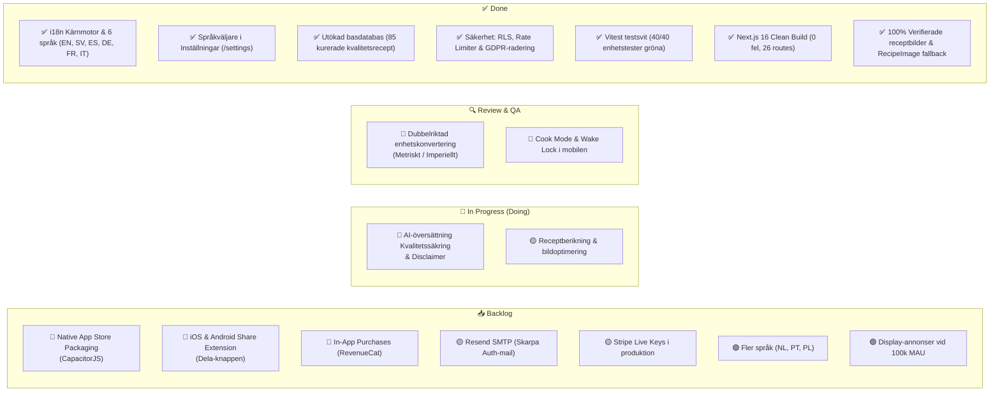

# 📋 Culineer • MVP Launch Kanban & Roadmap

Denna Kanban-tavla ger en visuell och strukturerad överblick över allt arbete som krävs inför den skarpa lanseringen av **Culineer** på webben, Apple App Store och Google Play Store.

---

## 🎨 Prioriteringsnyckel

| Tagg | Prioritet | Betydelse |
| :--- | :--- | :--- |
| 🔴 **P0** | **Kritisk / Blocker** | Måste vara 100% klart innan vi godkänner appen för App Store / Google Play och publik lansering. |
| 🟡 **P1** | **Hög / Launch Experience** | Viktigt för god användarupplevelse, retention och konvertering vid dag 1. |
| 🟢 **P2** | **Normal / V1.1 Update** | Planerat till första uppdateringen strax efter lansering (t.ex. ytterligare språk och butikskopplingar). |
| 🟣 **P3** | **Framtid / Skalning** | Aktiveras när vi når stor volym (100k+ aktiva användare), t.ex. display-annonser och sponsrade varumärkesrecept. |

---

## 📊 Kanban-översikt

---

## 🗂 Detaljerade Uppgiftskort per Kolumn

### ✅ 1. Done (Färdigställt)

* [x] **[i18n & Språk]** Kärnarkitektur för internationalisering skapad (`src/i18n/`) med typade lexikon för 6 språk: Engelska, Svenska, Spanska, Tyska, Franska och Italienska.
* [x] **[i18n & Språk]** Automatisk språkdetektering via enhetens/webbläsarens språk (`navigator.language`) med fallback till engelska för okända språk.
* [x] **[Inställningar]** Språkväljare med flaggor och modersmålsnamn integrerad i `/settings` med omedelbar uppdatering och Supabase-synk.
* [x] **[Navigering]** Toppnavigering, mobilmeny och humörfilter på hemskärmen översatta i realtid via `t(...)`.
* [x] **[Innehåll & Recept]** Receptdatabasen utökad från 34 till **85 kurerade kvalitetsrecept** med näringsdeklaration, foton och portionsskalning.
* [x] **[Bilder & Resiliens]** 100% verifierade matbilder för alla 85 recept, ersatt döda Spoonacular-länkar och lagt till `RecipeImage` med automatisk `onError`-fallback.
* [x] **[Säkerhet & GDPR]** Fullständiga Row Level Security (RLS) policies i Supabase, SSRF-blockering på URL-import, tiered rate limiting och GDPR-kontoborttagning.
* [x] **[Kodkvalitet & Byggstabilitet]** 40/40 enhetstester gröna i Vitest (inklusive bildintegritetstest); `next build` bygger 26 routes utan några TypeScript- eller kompileringsfel.

---

### 🔍 2. Review & Quality Assurance (Granskning)

#### 🔴 `[QA-01]` Dubbelriktad Enhetskonvertering (Metriskt $\leftrightarrow$ Imperiellt)
* **Beskrivning**: Verifiera att recept med t.ex. *cups/oz* räknas om till jämna, snygga *gram/dl/msk* när en användare har metriska inställningar, och vice versa.
* **Acceptanskriterier**:
  - Inga fula flyttal som "1.47294 cups" eller "14.283 g".
  - Ugnstemperaturer konverteras korrekt mellan Celsius och Fahrenheit.
  - Både fractions (1 ½, ¼) och heltal formateras snyggt.

#### 🔴 `[QA-02]` Cook Mode & Wake Lock i Mobilwebbläsare
* **Beskrivning**: Testa att skärmen inte stängs av medan användaren lagar mat med händerna i köket.
* **Acceptanskriterier**:
  - `navigator.wakeLock` aktiveras vid start av Cook Mode.
  - Släpps korrekt när användaren lämnar Cook Mode eller byter flik.

---

### 🚧 3. In Progress (Pågående)

#### 🔴 `[AI-01]` Kvalitetssäkring av AI-översättningar & Tydlig Disclaimer
* **Beskrivning**: Säkerställa att receptöversättningar håller hög kulinarisk klass och att en diskret ansvarsfriskrivning visas för användaren.
* **Åtgärder**:
  1. Lägg till en diskret notering i importmodalen och receptdetaljvyn:  
     *"AI Culinary Translation • Translations are optimized by culinary AI; ingredient nuances or local naming may occasionally vary."*
  2. Skriv enhetstester som verifierar att mått, siffror och ingrediensordning bevaras intakta vid flerspråkig översättning.

---

### 📥 4. Backlog (Planerat inför MVP & Framtid)

#### 🔴 `[MOB-01]` CapacitorJS Setup för iOS & Android *(MVP Blocker)*
* **Prioritet**: 🔴 **P0**
* **Beskrivning**: Installera `@capacitor/core`, `@capacitor/cli`, `@capacitor/ios` och `@capacitor/android` i projektet. Skapa Xcode- och Android Studio-projekten.
* **Acceptanskriterier**:
  - Appen startar och körs mjukt som native app på iOS Simulator och Android Emulator.
  - Splash screen och app-ikoner anpassade för App Store och Google Play.

#### 🔴 `[MOB-02]` Native OS Share Extension (Dela-knappen i mobilen) *(MVP USP)*
* **Prioritet**: 🔴 **P0**
* **Beskrivning**: Konfigurera iOS Share Extension och Android Intent Filter så att Culineer dyker upp i delningsmenyn när användaren är i Instagram, TikTok eller Safari/Chrome.
* **Acceptanskriterier**:
  - Klick på Dela $\rightarrow$ Culineer öppnar direkt importflödet och sparar receptet på användarens språk.

#### 🔴 `[MOB-03]` In-App Purchases via RevenueCat *(MVP Blocker)*
* **Prioritet**: 🔴 **P0**
* **Beskrivning**: Koppla ihop Apple App Store In-App Purchases och Google Play Billing via RevenueCat så att användare kan uppgradera till Chef Pro med Face ID / Touch ID.
* **Acceptanskriterier**:
  - Användare kan prenumerera direkt inuti iOS/Android-appen.
  - Användarens `subscription_tier` uppgraderas till `pro` i Supabase.

#### 🟡 `[OPS-01]` Resend SMTP för Skarpa E-postmeddelanden
* **Prioritet**: 🟡 **P1**
* **Beskrivning**: Ersätt Supabase inbyggda test-SMTP (som har strikta begränsningar på 3–4 mail per timme) med Resend för verifieringsmail och lösenordsåterställning.
* **Acceptanskriterier**:
  - Lösenordsåterställningsmail levereras på under 5 sekunder med snygg HTML-mall.

#### 🟡 `[PAY-01]` Stripe Live-nycklar & Skarp Produktionsmiljö
* **Prioritet**: 🟡 **P1**
* **Beskrivning**: Lägg in skarpa Stripe-nycklar och Webhook Secret i Vercel / produktionsmiljön för webbanvändare som prenumererar via datorn.

#### 🟢 `[I18N-02]` Expansion till Fler Språk (V1.1)
* **Prioritet**: 🟢 **P2**
* **Beskrivning**: Lägg till Nederländska (Nederlands), Portugisiska (Português) och Polska (Polski) efter att de första 6 språken validerats.

#### 🟣 `[ADS-01]` Display-annonser & Sponsrade Partners (Skalningsfas)
* **Prioritet**: 🟣 **P3**
* **Beskrivning**: Aktivera Google AdMob i mobilappen och diskreta bannerannonser via `AdBanner.tsx` för gratisanvändare när appen når 100 000+ månatliga användare. Chef Pro förblir alltid 100% annonsfritt.
